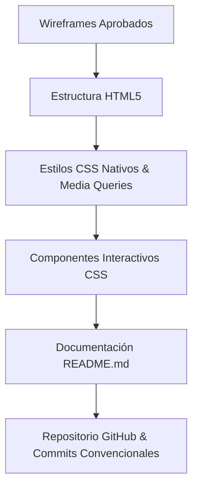

# 🐾 Sistema Publicitario — Fundación Patitas Felices

> **Transformando vidas, una patita a la vez.** Especificación técnica y de diseño para la maqueta web interactiva (HTML + CSS nativo).

---

## 🌟 1. Descripción General del Proyecto

La **Fundación Patitas Felices** busca expandir su impacto digital mediante una plataforma web institucional y de adopción. Este proyecto contempla el desarrollo de una maqueta web estática, altamente atractiva, accesible y totalmente responsive, implementando componentes interactivos basados exclusivamente en **CSS puro (sin JavaScript)**.

---

## 📋 2. Requerimientos Funcionales por Sección

### A. 🏠 Página de Inicio (Home)
*   **Banner Principal:**
    *   Identidad de la fundación (Logo y marca textual).
    *   Slogan inspirador: *"Dales una segunda oportunidad de amar"*.
    *   Botón principal de llamada a la acción (CTA): **"Adopta ahora"** / **"Conócenos"**.
*   **Carrusel de Fotografías:**
    *   Muestra momentos clave de rescates, voluntariado y actividades.
    *   *Transición automática cada 3 segundos* mediante `@keyframes` en CSS.
    *   Captions descriptivos superpuestos.
*   **Secciones Destacadas:**
    *   Resumen ejecutivo de la labor de la fundación.
    *   Accesos directos visuales a: *Adopta*, *Donaciones*, *Voluntariado* y *Contacto*.
    *   Testimonios breves de adoptantes felices.

### B. 🎯 Visión y Misión
*   **Diseño Adaptativo:** Layout flexible lado a lado en pantallas de escritorio, apilado verticalmente en dispositivos móviles.
*   **Elementos visuales:** Iconografía dedicada y espaciado consistente para cada pilar institucional.

### C. 🖼️ Galería / Carrusel Secundario
*   Mosaico interactivo simulado o carrusel de eventos y rescates recientes.
*   Diseño responsive que conserva proporciones óptimas en cualquier pantalla.

### D. 🐕 Animales Disponibles & Perfil Estático
*   **Catálogo (Grid de Tarjetas):** Mínimo 8 ejemplos representativos con:
    *   Fotografía clara.
    *   Nombre, edad aproximada, tamaño y raza.
    *   Estado dinámico simulado (`Disponible` / `Adoptado`).
    *   Botón **"Ver perfil"**.
*   **Vista Detallada del Animal:**
    *   Fotografía principal ampliada.
    *   Historial de rescate, estado de salud y rasgos de comportamiento.
    *   Especificaciones técnicas (edad, sexo, tamaño) y botón CTA de *Solicitud de Adopción*.
    *   Carrusel de animales relacionados.

### E. ✉️ Formulario de Contacto
*   **Campos Obligatorios:** Nombre, Apellidos, Ciudad, Correo electrónico, Teléfono, Tipo de consulta (`Adopción`, `Donación`, `Voluntariado`, `Información general`, `Otro`) y Mensaje.
*   **Validación Visual por CSS:**
    *   Uso de pseudo-clases (`:placeholder-shown`, `:invalid`, `:valid`) y clases de control (`.error`, `.success`).
    *   Información de contacto directo y redes sociales integradas.

### F. 🔻 Footer Institucional
*   Implementado con **Flexbox**.
*   Incluye nombre legal de la fundación, año actual y copyright, correo de contacto y enlace al equipo desarrollador.

---

## 🛠️ 3. Resultados Esperados y Entregables

1.  **Estructura de Código:** Organizada modularmente en carpetas (`/css`, `/img`, `/js` [opcional/vacío], archivos HTML).
2.  **Diseño Responsive:** Mínimo **3 breakpoints** implementados mediante media queries profesionales.
3.  **Interactividad CSS:** Animaciones de carrusel y estados visuales de formulario sin dependencias de JS.
4.  **Documentación (README.md):** Guía de ejecución, capturas de pantalla y descripción detallada.
5.  **Control de Versiones:** Repositorio en GitHub con historial bajo la especificación de **Conventional Commits** (ej. `feat: add animal grid component`, `style: fix mobile responsiveness`).

> ⚠️ **Nota Importante:** La fase de codificación iniciará únicamente tras la validación y aprobación de los wireframes por parte de la docencia o dirección del proyecto.